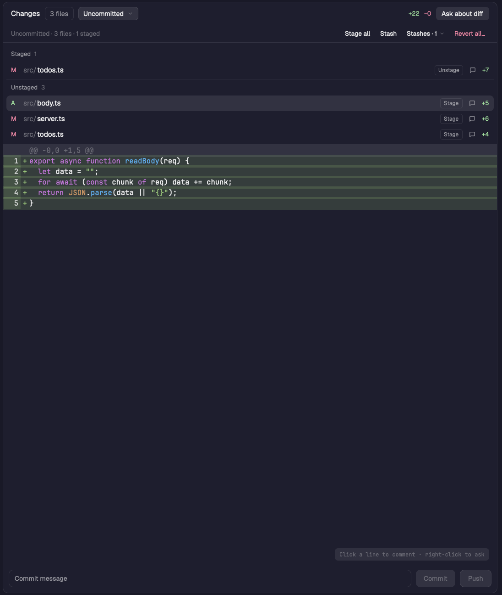

# Changes Plus

A git panel for the Herdr app. It shows the uncommitted changes of the repo you're working in, split into Staged and Unstaged, with a syntax-colored diff of the selected file. From the panel you can:

- stage or unstage one file, or everything
- revert a file, or delete it if it was never committed
- stash your changes and apply a stash
- commit and push
- leave review comments on diff lines and send them to the space's agent as one message

It builds on the shipped `changes` mod and the community `reviewer` mod.



## Install

Copy `mods/changes-plus/` into `~/.config/herdr-app/mods/`. The mod's `mod.json` says `"place": "none"`, so Herdr doesn't dock it on its own. Point a layout's Changes block at it:

```json
{ "id": "changes", "type": "block", "content": { "mod": "changes-plus" } }
```

Shipped layouts are read-only. Clone one first with `herdr-app do layout.clone '{"name":"main","as":"mine"}'`, then edit the `changes` block in `layouts/mine.json`.

No keys are bound by default. The mod answers these key commands if you bind them in `keys.json` (for example `"global": { "ctrl-alt-r": "changes-plus.submit" }`):
- `changes-plus.submit`: send the review
- `changes-plus.ask`: ask about the open diff
- `changes-plus.clear`: drop the draft comments
- `changes-plus.scope`: cycle the scope

In the send dialog, `changes-plus.send` and `changes-plus.close` also work.

## What you see

One panel, top to bottom, on the theme's `background` with a 1 px `border` and 10 px corners. UI text is 13 px unless noted.

1. **Header (42 px):**
   - "Changes" in semibold.
   - A pill with the file count.
   - A scope picker (24 px select box with a chevron) reading "Uncommitted", "Last commit" or "vs <base>".
   - A spacer, then the total `+N` in `ansi2` and `−N` in `ansi1` (11 px).
   - "Ask about diff" (a raised button) when there are no draft comments. When there are drafts, "Discard" (a dim link) and "Submit review · N" (a solid button) instead.
2. **Action bar (32 px, 11.5 px text):** shown when the working tree has changes or the repo has stashes.
   - On the left, in dim text: "Uncommitted · N files · M staged", or "No uncommitted changes".
   - On the right, as text buttons: "Stage all" or "Unstage all", "Stash", "Stashes · N" with a chevron, and "Revert all…" in `ansi1`.
   - Disabled buttons are dim at 60 % opacity.
3. **File list:** 6 px padding, a border below, height `min(260, max(44, rows × 28 + sections × 30 + 12))`, scrolls past that.
   - It is split into sections, each with a 30 px header: the label in 11 px semibold `muted`, then the count in `dim`. Every header after the first has a 1 px `border` above it.
   - The sections are **Staged**, then **Unstaged**, then **Committed**. Committed appears only in the Last commit and vs base scopes and holds files with no uncommitted change.
   - Rows are 28 px with 7 px corners. The selected file's rows are `selected` and hover is `hover`. Each row has:
     - a status letter (11 px): `A` in `ansi2`, `D` and `U` in `ansi1`, anything else in `blocked`
     - the folder in `dim` and the file name in `foreground`, both truncated
     - a bordered 18 px "Stage" or "Unstage" button (10 px text)
     - a comment bubble icon, which shows a count on an `accent` tint when the file has draft comments
     - `+N` and `−N` (11 px)
4. **Diff:** fills the rest. It uses the terminal font (settings `font`, else JetBrains Mono) at the terminal size minus one. Rows are `round(size × 1.8)` tall. It scrolls both ways, with a vertical scrollbar over it.
   - `@@` hunk headers sit on `raised` in `dim`.
   - Added and removed rows are tinted with the palette's added or removed color at alpha `30`, rising to `5c` when targeted by a comment.
   - Each row has a tinted line-number gutter and a sign column (`+`, `−`).
   - Code is token-colored by the palette.
   - Draft comments sit inline under their last line as cards with an `accent` border.
   - A dim hint in the bottom right reads "Click a line to comment · right-click to ask".
5. **Comment box:** a 300 px card floating over the top right of the diff (`surface` at alpha `eb`, `lg` shadow). Below 600 px of panel width it becomes a strip under the diff instead. It holds:
   - a title, a "?" help chip and a × button
   - the file and line range
   - a 4-to-14-row textarea
   - "Add comment" (or "Save"), "Cancel", and "Delete" when editing
6. **Bottom bar (10 px padding):** a 32 px commit message input with a border that turns `accent` while focused, then "Commit" (`solid` when enabled, `raised` and `dim` when not), then "Push". Push shows "Push ↑N" when there are unpushed commits.

Overlays opened by the panel:
- **File menu:** a 240×92 popup at the pointer. It shows the file name and its folder, then one item in `ansi1`: "Revert changes…", "Delete file…", or a dim "No uncommitted changes".
- **Confirm dialogs:** "Revert <name>?" or "Delete <name>?" (420×170), and "Revert all uncommitted changes?" (440×200). Each has a title, an "Esc" hint, a muted explanation, and Cancel plus a red confirm button.
- **Send dialog:** 680×560 with context, 560×250 without. It has:
  - "Ask the agent" and a title
  - a "To" agent picker with a status dot
  - a note textarea
  - the read-only context in the terminal font, which scrolls both ways and has a Copy link
  - a warning above 8 KB of context
  - Cancel, and Send (or "Send anyway", or "Start Claude")

## How it behaves

**Which repo.** The repo is the focused pane's folder, else the active space's folder, resolved with `git rev-parse --show-toplevel`. For a space on another machine, every command runs there (`exec(..., { on })`). The panel reloads in these cases:
- the folder watcher fires (local only)
- every 10 s
- you switch to a different repo
- after an action

A refresh that arrives while one is running is dropped, unless it follows an action.

**Scopes.** The scope picker chooses what the file list and diff compare against:
- **Uncommitted:** HEAD.
- **Last commit:** `HEAD~1`, so the diff is the last commit plus your uncommitted changes. Only offered when HEAD has a parent.
- **vs base:** the merge base with the base branch, so the diff is everything on the branch. The base branch is the `base` prop, else `origin/HEAD`, else `main`, else `master`. Only offered off the base branch.

The choice is remembered per repo in the shared key `reviewer.scope`. A repo opens on vs base when it is offered, else Uncommitted.

**File list.** Files come from `git diff <ref> --name-status` plus `git --no-optional-locks status --porcelain=v1 -z --no-renames --untracked-files=all`. The list is capped at 1,000 files, with a note when cut. A file is sorted into sections by its two-letter status code:
- **Staged:** the index column is set (not untracked, not a conflict). Its letter comes from the index column and its counts from `git diff --cached --numstat`.
- **Unstaged:** the work-tree column is set, or the file is untracked (`A`), or it is a conflict (`U`). Its counts come from `git diff --numstat`.
- A file that is staged and then edited again is in both sections.

The first file opens by itself. Clicking a row opens its diff; clicking the open file closes it.

**Stage and unstage.**
- **Stage** on an Unstaged row runs `git add -A -- <path>`, which also stages deletions.
- **Unstage** on a Staged row runs `git restore --staged -- <path>`, or `git rm --cached` in a repo with no commits.
- **Stage all** (`git add -A`) becomes **Unstage all** (`git reset -q`) when every changed file is fully staged.
- The clicked row's button shows "…" while git runs.

**Revert.** Right-clicking any file row opens the file menu. Choosing its item closes the popup and opens a confirm dialog, where Enter confirms and Esc cancels.
- A file HEAD has (status code not `??` and not starting with `A`): `git restore --source=HEAD --staged --worktree -- <path>`.
- An untracked file: `git clean -f -- <path>`.
- A file staged as new: `git rm -f -- <path>`.
- **Revert all…** confirms with how many tracked files it resets and how many new files it deletes, then runs `git reset --hard HEAD` and `git clean -fd`. Ignored files are left alone. It is disabled without commits.

**Stash.**
- **Stash** runs `git stash push --include-untracked`. It is disabled without commits.
- **Stashes · N** opens a 340 px dropdown of `git stash list`, newest first. Each row shows the message, then `stash@{n} · <age>`, then Apply (`git stash apply <ref>`) and Pop (`git stash pop <ref>`).

**Commit and push.**
- **Commit** is enabled once the message has text. It runs `git add -A` and `git commit -m <message>`, then clears the input. Enter in the input commits too.
- **Push** runs `git push` when the branch has an upstream and is ahead of it. With no upstream it runs `git push -u <remote> HEAD`, using `origin` or the first remote. It is disabled when up to date, on a detached HEAD, or with no remote, and its tooltip says why.

**Review.**
- **Making a comment:**
  - Click a diff line to open the comment box on it. A second click on another line widens the range, and a click inside the range clears it. Clicking a `@@` header targets its whole hunk.
  - Enter adds the comment and Shift-Enter adds a newline. Esc closes the box. Cmd/Ctrl-Enter adds it from anywhere in the panel.
  - Click an inline comment to edit it, with Save and Delete. The bubble on a file row comments on the whole file.
- **Drafts:** they persist per repo and scope in the shared key `reviewer.drafts` (`<machine>:<root>:<scope>`). A comment whose lines leave the diff keeps the quote captured when it was made.
- **Submit review:** builds one message. It names the repo and scope, then for each comment gives `### <path>, lines a-b`, the quoted rows (new-file numbers, `-` for removed rows) and `Comment: <text>`. It opens the send dialog with that message.
- **Asking:** right-click a diff line (or a hunk header) to ask about those lines. "Ask about diff" asks about the whole open file.
- **The send dialog:**
  - It targets an agent in the active space: the one you pick, else the focused one, else an idle one, else the first.
  - Sending to a working or blocked agent asks "Send anyway" first.
  - It sends the note, then the context, as one `hc send` (`--force` for a busy agent), then focuses that agent.
  - With no agent in the space, it starts `claude` in a new tab with the text as its task.
  - A sent review sets the shared key `reviewer.sent`, which clears the drafts.

**Errors.** Git errors from the panel's actions show in red under the diff. Errors from the overlays show as an error toast.

## Built from

- `mods/changes-plus/`, a JavaScript gpui-kit mod: `main.js` default-exports `class Changes extends View`.
  - When `props()` has `dialog`, `menu`, `revertFile` or `revertAll`, `init` hands the copy to `Dialog` (`dialog.js`) or `Overlay` (`menu.js`), and `render` delegates to it. The overlays are copies of this same mod opened with `openOverlay({ mod: "changes-plus", ... })`.
  - `git.js`: every working-tree action and `pushInfo` (branch, upstream, commits ahead, remote) and `stashList`. Path-taking commands run as `git --literal-pathspecs ...`.
  - `ask.js`: opens the send dialog, falling back to `hc send` to the picked agent.
  - `highlight.js`: a line tokenizer that carries block-comment and triple-quote state across lines. It covers JS/TS, Rust, Python, Go, C/C++/Obj-C, Java/Kotlin/C#/Scala, Ruby, PHP, shell, SQL, CSS, HTML/XML/Vue/Svelte, YAML/TOML, JSON and Swift, chosen by file extension.
  - `palette.js`: token colors. The `palette` prop picks `one-dark-pro` (the default), `dark-plus`, or `theme` (built from the Herdr theme's ANSI colors).
  - SVG icons: `changes.svg`, `check.svg`, `chevron-down.svg`, `comment.svg`, `copy.svg`.
- Props: `palette`, `font_size` (px), `base` (the review base branch).
- `herdr` functions used: `exec`, `hc`, `readTextFile` (untracked files are read and shown as all-added, first 1,500 lines), `watchFolder`, `openOverlay`, `closeOverlay`, `notify`, `run("pane.focus")`, `run("tab.new")`, `agents`, `spaces`, `panes`, `focused`, `theme`, `settings`, `shared`, `setShared`, `nextCommand`, `props`.
- gpui-base parts used: `InputState`/`Input`, `TextareaState`/`Textarea`, `v_virtual_list` with `VirtualListScrollHandle` for the diff, `Scrollbar`, and `Popover` for the scope picker, agent picker and stash list.
- Shared keys:
  - `reviewer.drafts`, `reviewer.scope` and `reviewer.sent`, shared with `reviewer` so drafts carry over.
  - `changes-plus.changed`, set by the overlays after a git action so every panel copy reloads.
- Programs run: `git` (on the space's machine) and `hc`.

## Watch out

- Run the refresh's `git status` with `--no-optional-locks`. Without it, status can write `.git/index`, which fires `watchFolder` while the refresh is running. If that event queues another refresh, the panel reloads forever and every button that waits for a refresh stays disabled. Queue a follow-up refresh only after a user action.
- Don't disable Commit, Push or the bar buttons while a background refresh runs. Refreshes are frequent and the buttons look broken.
- Run `git stash` without `--literal-pathspecs`. Under that flag, `stash push --include-untracked` stashes tracked changes but leaves new files in place, and a later apply fails with "already exists, no checkout".
- Use `--literal-pathspecs` everywhere else, or a file named like `:odd.txt` is read as pathspec magic.
- A diff row in the virtual list can't hold an input, so the comment box must float over the diff (or dock under it). It must stop mouse down, up and click, or the click that closes it falls through and reopens it on the row underneath.
- Element ids must be unique. A file in both Staged and Unstaged needs the section in its row, button and bubble ids.
- `exec` has a 30 s limit and no TTY. A push that prompts for credentials, or takes longer than 30 s, fails with git's error.
- Herdr starts each overlay as a new copy of the mod. Keep overlay setup in `init` before any panel state, and never start the panel's timers in an overlay copy.
- Diff limits: 1,500 lines per file, lines over 4,000 characters cut, at most 400 rows sent per ask.

## Done when

- `herdr-app check ~/.config/herdr-app/mods/changes-plus` passes.
- In a repo with one file staged and then edited again, one unstaged edit and one untracked file, the list shows:
  - Staged with 1 file, then a border, then Unstaged with 3 files
  - the twice-edited file in both sections, with different +/− counts
- The Stage button on an Unstaged row moves the file to Staged. Unstage moves it back. A deleted file stages too.
- Stage all moves everything to Staged and the button reads "Unstage all". Unstage all empties Staged.
- Right-click a modified file, choose Revert changes…, and confirm: it leaves the list and matches HEAD. On an untracked file, Delete file… removes it from disk.
- Revert all… leaves `git status` clean.
- Stash leaves the tree clean and "Stashes · 1" appears. Apply brings back the changes, including new files, and keeps the stash. Pop brings them back and removes it.
- After a commit, Push reads "Push ↑1". Pressing it pushes, and the button greys out.
- Click a diff line, type, press Enter: the comment appears under the line and Submit review · 1 shows. Submit opens the send dialog with the quoted line, and sending clears the draft.
- Switching the scope to Last commit lists the last commit's files under Committed.
